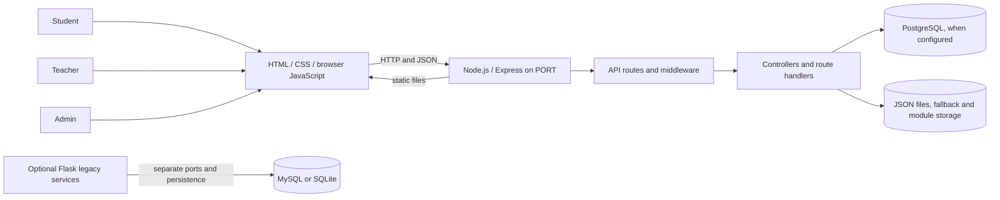
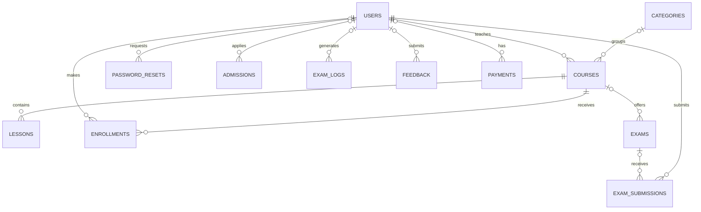

# Online Education Platform

A web-based learning platform with Student, Teacher, and Admin portals. The primary application uses a static HTML/CSS/JavaScript frontend served by a Node.js and Express API. Data is stored in PostgreSQL when configured and available; several application modules also use local JSON files.

> **Implementation status:** This repository contains working API-backed flows alongside prototypes and incomplete features. It is not a verified production-ready learning management system or payment platform.

## Contents

- [Project overview](#project-overview)
- [Features and implementation status](#features-and-implementation-status)
- [Technology stack](#technology-stack)
- [Architecture](#architecture)
- [Project structure](#project-structure)
- [Prerequisites](#prerequisites)
- [Installation and setup](#installation-and-setup)
- [Environment variables](#environment-variables)
- [Running the application](#running-the-application)
- [Database](#database)
- [API reference](#api-reference)
- [Authentication and security](#authentication-and-security)
- [Deploying to Render](#deploying-to-render)
- [Troubleshooting](#troubleshooting)
- [Testing](#testing)
- [Future improvements](#future-improvements)
- [License](#license)

## Project overview

The platform brings together course discovery and learning pages with basic administration workflows:

- **Students** can register and sign in, view a dashboard and course catalog, enroll, manage profile details, submit feedback, view mock-test results, and request a certificate for a completed course.
- **Teachers** can sign in, manage their courses and assignments, record attendance for enrolled students, and view reports based on saved attendance and assignment data. Gradebook entry and file attachments are not connected.
- **Admins** can sign in, inspect summary data, manage course/category records, toggle student and teacher account status, review enrollments, broadcast notifications, and save platform settings.

The project is a learning-platform prototype. Practice exam results are persisted to the signed-in student's account, but scoring remains browser-calculated and unverified. Payment processing, verified grading, and password-reset email delivery are not complete.

## Features and implementation status

“Implemented” means a corresponding frontend/backend flow is present; it does not imply production readiness. “Partial” means only some of the flow is connected. “Not implemented” means no working end-to-end feature was found.

### Student Portal

| Feature | Status | Notes |
|---|---|---|
| Registration and login | Implemented | Registration creates student accounts; login returns a JWT. |
| Dashboard | Partial | Uses student API data, much of which is derived from JSON files. |
| Course browsing and enrollment | Partial | Course list and enrollment APIs exist; enrollment records are JSON-backed. |
| Attendance | Not implemented | No student attendance workflow/API was found. |
| Examinations and results | Partial | Practice results are saved through an authenticated API and can be retrieved by the same student. Scores are browser-calculated and explicitly unverified, not official grades. |
| Certificates | Partial | API can issue a certificate record for a completed enrollment; this is not an external certificate-verification service. |
| Billing and payments | Partial | Authenticated billing is read-only. Payment records can be displayed, but fee totals, invoices, installments, and payment-provider checkout are unavailable. |
| Feedback | Implemented | Authenticated API validates and stores feedback. |
| Profile management | Partial | Profile text fields use the API; profile image handling is browser-local. |

### Teacher Portal

| Feature | Status | Notes |
|---|---|---|
| Authentication | Partial | Teacher login uses the API; registration is not a self-service workflow and password reset returns HTTP 501. |
| Dashboard | Partial | A teacher-scoped dashboard API exists; not all dashboard content is dynamic. |
| Student and course management | Partial | Teacher-scoped course and enrollment APIs exist; student administration remains limited. |
| Attendance | Implemented | Teachers can save and retrieve per-course, per-date attendance for enrolled students through authenticated JSON-backed APIs. |
| Assignments | Partial | Teachers can create and list owned-course assignments. Student submissions, grading, and attachments are not connected. |
| Reports | Partial | Authenticated reports summarize saved attendance and available assignment/submission data; export is unavailable. |
| Profile and resources | Partial | Several pages use static or local-only behavior; resource downloads are disabled. |

### Admin Portal

| Feature | Status | Notes |
|---|---|---|
| Authentication and dashboard | Implemented | Admin login and summary API are present; protected APIs require the admin role. |
| Student and teacher management | Partial | List and activate/deactivate flows exist; create/edit workflows were not found. |
| Course and category management | Implemented | Admin APIs support create/list/status changes and delete operations. |
| Enrollment management | Partial | Read-only list. |
| Billing management | Not implemented | No Admin billing page or API was found. |
| Reports and notifications | Partial | Reports are summary-only; notification broadcast/history APIs exist. |
| Settings | Implemented | Settings are validated and persisted in local JSON storage; public registration follows the saved registration toggle. |

## Technology stack

| Technology | Use |
|---|---|
| HTML5, CSS3, browser JavaScript | Student, Teacher, Admin, and legacy frontend pages. The primary UI is not React or Vite-based. |
| Node.js | Runtime for the primary application. `package.json` does not declare a Node `engines` range. |
| Express.js 5 | Serves the frontend and JSON APIs. |
| PostgreSQL and SQL | Optional relational persistence and schema. PostgreSQL is not the source of truth for every module. |
| JSON files | Fallback/local persistence and storage for a number of student, teacher, and admin resources. |
| Python Flask | Separate optional legacy web app and monitoring service; neither replaces the primary Express server. |

Key root npm dependencies include Express, `pg`, `bcryptjs`, `jsonwebtoken`, `dotenv`, `cors`, and `body-parser`. `html-pdf` is also declared for a PDF utility, although its browser-loaded path uses Node-specific APIs. Other declared packages (`mongoose`, `mysql`, `mysql2`, `pg-hstore`, and `@fortawesome/fontawesome-free`) had no direct import found in the primary authored application during the audit; checked-in Font Awesome assets are used by the pages. The separate Python requirements are in [`design/requirements.txt`](design/requirements.txt).

## Architecture

Express serves the static `design/` directory and mounts role-specific REST routers. Authentication middleware validates bearer JWTs and checks the current user record and role. Storage is mixed: some services use PostgreSQL with JSON fallback, while many course/enrollment/assignment/admin operations read and write JSON directly.



The Flask site and monitor are separate processes: [`design/app.py`](design/app.py) is the legacy site, and [`design/monitor_server.py`](design/monitor_server.py) is a monitor service using SQLite. The legacy site also contains older MySQL-dependent form routes.

## Project structure

```text
Online Education/
├── .vscode/                         VS Code launch/settings configuration
├── db/
│   ├── schema.sql                   PostgreSQL schema and initial seeds
│   └── migrations/
│       └── 001_initial_schema.sql   Initial schema SQL
├── design/
│   ├── admin/{css,html,js}/          Admin portal
│   ├── student/
│   │   ├── css/{base,components,layouts,pages}/
│   │   ├── html/                    Student pages, lessons, and assessments
│   │   └── js/{auth,pages,services,shared}/
│   ├── teacher/{css,htmlfiles,js}/  Teacher portal (lowercase for case-sensitive hosts)
│   ├── assets/                      Images, fonts, and checked-in Font Awesome assets
│   ├── css/ and js/                 Legacy/shared frontend assets
│   ├── app.py                       Optional legacy Flask site
│   └── monitor_server.py            Optional Flask/SQLite monitor
├── docs/
│   └── reports/                     Project and module reports
├── server/
│   ├── config/                      Database, data directory, and JWT configuration
│   ├── controllers/                 Auth, admin, and academic handlers
│   ├── middleware/                  JWT and role authorization
│   ├── routes/                      Auth, student, teacher, admin, academic APIs
│   ├── scripts/                     PostgreSQL migration CLI and utilities
│   ├── services/                    PostgreSQL/JSON persistence services
│   ├── data/                        Local JSON data (do not commit real records)
│   └── server.js                    Primary Express entry point
├── test/
│   ├── api/                         Isolated API integration/security test
│   ├── e2e/, integration/, unit/     Sample tests
│   └── python/                      Monitor service tests
├── .env.example                     Safe environment-variable template
├── package.json                     npm scripts and dependencies
└── README.md
```

Generated directories such as `node_modules`, `.git`, build output, and caches are intentionally omitted.

## Prerequisites

- Node.js and npm. Use a currently supported Node.js LTS release; the project does not pin a specific version in `package.json`.
- Git to clone the repository.
- PostgreSQL only if using the relational database. Local development can run in JSON fallback mode.
- PowerShell for the Windows commands below.
- VS Code is optional. No special extension is required.
- Python and pip are needed only for the optional Flask services.

## Installation and setup

### 1. Get the repository

Replace the placeholder with the repository URL you have access to; no clone URL is embedded because one is not configured in the project documentation.

```powershell
git clone <repository-url> "Online Education"
Set-Location "Online Education"
```

If the repository is already open in VS Code, open a terminal at its root instead.

### 2. Install Node dependencies

```powershell
npm.cmd install
```

`npm.cmd` avoids PowerShell's `npm.ps1` execution-policy error without changing the machine's execution policy.

### 3. Create and configure `.env`

```powershell
if (-not (Test-Path .env)) {
  Copy-Item .env.example .env
}
```

Generate a private JWT secret, then place the output in `.env`:

```powershell
node -e "console.log(require('crypto').randomBytes(32).toString('hex'))"
```

Set `JWT_SECRET` to a value at least 32 bytes long. Keep `.env` private and never commit real credentials or user data.

### 4. Configure PostgreSQL (optional)

Create a database, for example:

```powershell
createdb -U postgres education_platform
```

Alternatively, in `psql`:

```sql
CREATE DATABASE education_platform;
```

Set either `DATABASE_URL` **or** the individual `PG*` variables in `.env`. Then run the migration CLI:

```powershell
npm.cmd run db:migrate
```

The CLI applies ordered SQL files from [`db/migrations/`](db/migrations/) once per database and records applied filenames in `schema_migrations`. Migration failures return a non-zero process exit code. The initial migration is idempotent and can initialize or update a database that has the same schema.

Without a valid PostgreSQL connection, Express can start with local JSON storage. JSON data is not automatically synchronized with PostgreSQL.

## Environment variables

These are read by the application or its database/migration setup:

| Variable | Required | Purpose |
|---|---|---|
| `JWT_SECRET` | Yes | JWT signing and verification. The server refuses a missing or shorter-than-32-byte value. |
| `PORT` | No | Express listening port; defaults to `5000`. |
| `NODE_ENV` | No | Application mode; `test` prevents the PostgreSQL pool from being initialized. |
| `DATABASE_URL` | No | PostgreSQL connection URL. Takes precedence over individual `PG*` settings. |
| `PGHOST` | No | PostgreSQL host; defaults to `localhost`. |
| `PGPORT` | No | PostgreSQL port; defaults to `5432`. |
| `PGDATABASE` | No | PostgreSQL database; defaults to `education_platform`. |
| `PGUSER` | No | PostgreSQL user; defaults to `postgres`. |
| `PGPASSWORD` | No | PostgreSQL password. Set it explicitly for your environment. |
| `DATA_DIR` | No | Override for JSON storage directory; defaults to `server/data`. |
| `CORS_ORIGIN` | No | Comma-separated list of exact allowed browser origins. Wildcard `*` is ignored. |

`JWT_EXPIRES_IN` appears in the sample environment file, but token expiry is currently hard-coded to seven days in the auth controllers; changing that variable has no effect.

Safe template:

```dotenv
NODE_ENV=development
PORT=5000
JWT_SECRET=replace-with-a-private-random-value-of-at-least-32-bytes

# Use DATABASE_URL or configure the PG* variables below.
DATABASE_URL=
PGHOST=localhost
PGPORT=5432
PGDATABASE=education_platform
PGUSER=postgres
PGPASSWORD=replace-with-your-local-database-password

DATA_DIR=
CORS_ORIGIN=http://localhost:5000,http://127.0.0.1:5000
```

## Running the application

The commands defined in [`package.json`](package.json) are:

| Command | Script |
|---|---|
| `npm.cmd start` | `node server/server.js` |
| `npm.cmd run dev` | `node server/server.js` (same behavior as `start`; no watcher) |
| `npm.cmd test` | `node test/api/api.test.js` |
| `npm.cmd run db:migrate` | `node server/scripts/migrate.js` |

Start the primary app from the repository root:

```powershell
npm.cmd start
```

Express serves both the frontend and APIs:

- Application: <http://localhost:5000/>
- Health check: <http://localhost:5000/api/health>

The health endpoint reports the PostgreSQL connection/fallback mode, but `status: online` means the web process is up; it does not guarantee every feature uses PostgreSQL.

Stop with **Ctrl+C** in the terminal running the server. Start it again with `npm.cmd start`. If the port is occupied, stop the existing process or choose another `PORT` in `.env`.

The optional Flask site and monitor are not required for the primary app. Their Python dependencies are listed in [`design/requirements.txt`](design/requirements.txt); see [`HOW_TO_RUN.md`](HOW_TO_RUN.md) for their separate ports and setup. A static file server such as VS Code Live Server does not provide the Express APIs or database integration.

## Database

### PostgreSQL tables

The schema creates these tables:

| Table | Purpose |
|---|---|
| `users` | Student, teacher, and admin accounts and password hashes |
| `password_resets` | Reset-token schema; end-to-end email reset is not implemented |
| `admissions` | Admission submissions |
| `categories` | Course categories |
| `courses` | Course metadata and optional instructor/category references |
| `lessons` | Course lessons |
| `enrollments` | User/course enrollment and progress |
| `exams` | Exam metadata |
| `exam_submissions` | Exam result schema; no matching REST submission flow was found |
| `exam_logs` | Monitoring/proctoring events |
| `feedback` | Feedback submissions |
| `payments` | Payment transaction records; no checkout/provider write flow is implemented |

The schema defines foreign keys between users, courses, categories, lessons, enrollments, exams, submissions, feedback, admissions, logs, and payments. Application modules do not all use these tables: several instead read/write JSON files under `DATA_DIR`.



Run `npm.cmd run db:migrate` only after PostgreSQL is reachable and the target database exists. The script applies ordered SQL files from `db/migrations/` and tracks applied migration filenames in `schema_migrations`. The initial migration contains demonstration seed accounts; remove or replace demo records before deployment.

## API reference

All paths below are mounted by the Express app. Unless noted otherwise, protected routes require `Authorization: Bearer <JWT>`. Responses generally use JSON and many return a `success` field.

### Authentication

| Method and path | Purpose | Auth | Request body |
|---|---|---|---|
| `POST /api/auth/register` | Register a student | Public | Required: `name`, `email`, `phone`, `dob`, `password`; optional `confirmPassword`, `designation`. |
| `POST /api/auth/login` | Sign in an account with an allowed role | Public | `email`, `password`. The Admin portal also exposes `/api/admin/login`. |
| `POST /api/auth/forgot-password` | Password reset request | Public; returns 501 | No functioning reset flow; email delivery is not configured. |
| `POST /api/admin/login` | Admin sign-in | Public | `email`, `password`; account must have the admin role. |

### Student

All `/api/students` routes require a student JWT.

| Method and path | Purpose | Request body |
|---|---|---|
| `GET /api/students/profile` | Read current student's profile | — |
| `PUT /api/students/profile` | Update profile | `name`, `phone`, `dob`, `designation` |
| `GET /api/students/dashboard` | Dashboard summary | — |
| `GET /api/students/courses` | Available courses and current student's enrollments | — |
| `POST /api/students/enroll` | Enroll the authenticated student | `courseId` |
| `GET /api/students/progress/:courseId` | Read course progress | — |
| `GET /api/students/certificates` | List certificates | — |
| `POST /api/students/certificates` | Issue/retrieve certificate for a completed enrollment | `courseId` |
| `GET /api/students/certificate/:courseId` | Read issued certificate | — |
| `GET /api/students/billing` | Read current student's payment summary/transactions | — |
| `GET /api/students/exam-results` | List current student's saved practice results | — |
| `POST /api/students/exam-results` | Save a practice result | `score`, `totalPoints`, `timeTakenSeconds`, `answers`; identity is taken from the JWT |

Billing is read-only. The response can include existing student-specific payment records, but fee totals may be `null`; fee breakdowns, invoices and installments are empty, and `paymentProviderConfigured` is `false`.

### Teacher

All `/api/teachers` routes require a teacher JWT.

| Method and path | Purpose | Request body |
|---|---|---|
| `GET /api/teachers/dashboard` | Teacher dashboard summary | — |
| `GET /api/teachers/courses` | List teacher-owned courses | — |
| `POST /api/teachers/courses` | Submit a course for admin approval | Required: `title`; optional: `category`, `level`, `duration`, `description` |
| `GET /api/teachers/assignments` | List assignments for teacher-owned courses | — |
| `POST /api/teachers/assignments` | Create course assignment | Required: `course_id`, `title`, `total_marks`; optional: `deadline`, `description` |
| `GET /api/teachers/students` | List enrollments in teacher-owned courses | — |
| `GET /api/teachers/attendance?course_id=<id>&date=YYYY-MM-DD` | Read attendance for an owned course and date | — |
| `POST /api/teachers/attendance` | Save attendance for every enrolled student | `course_id`, `date`, `records` |
| `GET /api/teachers/reports?start_date=YYYY-MM-DD&end_date=YYYY-MM-DD` | Read attendance and assignment summaries | — |
| `GET /api/teachers/proctor-logs` | Read logs associated with teacher courses | — |

These endpoints currently use JSON storage.

### Admin

All `/api/admin` routes below `/login` require an admin JWT.

| Method and path | Purpose | Request body |
|---|---|---|
| `GET /api/admin/stats` | Dashboard summary | — |
| `GET /api/admin/students` | List students | — |
| `POST /api/admin/students/toggle-status` | Toggle student active status | `id` |
| `GET /api/admin/teachers` | List teachers | — |
| `POST /api/admin/teachers/toggle-status` | Toggle teacher active status | `id` |
| `GET /api/admin/courses` | List courses | — |
| `POST /api/admin/courses` | Create course | Required: `title`, `category`; optional: `level`, `duration`, `instructor`, `description` |
| `PUT /api/admin/courses/:id/status` | Change course status | `status` |
| `DELETE /api/admin/courses/:id` | Delete course | — |
| `GET /api/admin/categories` | List categories | — |
| `POST /api/admin/categories` | Create category | Required: `name`; optional: `description`, `icon` |
| `DELETE /api/admin/categories/:id` | Delete category | — |
| `GET /api/admin/enrollments` | List enrollments | — |
| `GET /api/admin/assignments` | List assignments | — |
| `GET /api/admin/reports` | Read summary report values | — |
| `GET /api/admin/notifications` | List notifications | — |
| `POST /api/admin/notifications` | Create/broadcast notification | Required: `title`, `message`; optional: `target` |
| `GET /api/admin/settings` | Read persisted settings and defaults | — |
| `POST /api/admin/settings` | Save platform name, support email, and registration state | One or more of `platform_name`, `support_email`, `registration_open` |

### Academic and other routes

| Method and path | Purpose | Auth | Request body |
|---|---|---|---|
| `POST /api/feedback` | Submit feedback attributed to the authenticated student | Student JWT | `subject`, `feedback`, `rating` (1–5) |
| `POST /api/admission` | Submit admission application | Public | Admission fields: `fullName`, `dob`, `gender`, `previousDegree`, `email`, `phone`, `address`; optional `cgpa`, `yearOfPassing`. Required fields and schema ranges are validated before storage; a failed SQL insert falls back to JSON storage. |
| `POST /api/log` | Submit monitoring event; identity comes from token | Student JWT | `event`, optional `details`, optional supported image data URL |
| `GET /api/logs` | Read recent monitoring logs | Admin JWT | — |
| `GET /api/health` | Report process and database connection status | Public | — |

Legacy root aliases (`/register`, `/login`, `/forgot-password`, `/submit-admission`, and others) are retained in the server for compatibility. Prefer the `/api/...` endpoints. The legacy `/submit-feedback` alias does not attach the authentication middleware required by its controller and should not be used.

## Authentication and security

- Passwords are hashed with `bcryptjs` using a cost factor of 10; raw passwords are not returned in API responses.
- Successful login returns a JWT signed with `JWT_SECRET`, currently configured to expire after seven days.
- Protected routes accept a bearer token. Middleware verifies the JWT, reloads the account, and checks its active status and role.
- Student, Teacher, and Admin route groups enforce their respective roles. Registration creates student accounts; it does not provide a public teacher/admin registration flow.
- Admin registration settings are stored in JSON and the student registration endpoint honors the saved open/closed state.
- CORS allows same-origin local requests plus configured exact origins. Wildcard `CORS_ORIGIN=*` is ignored.
- `JWT_SECRET` must be private and at least 32 bytes. Never commit `.env`, real database credentials, tokens, or real user records.
- The SQL schema seeds demonstration accounts. Treat seed data as non-production and remove/reset it before using the database with real users.
- Express and the optional Flask file server now allow only public web/media file extensions; database files, JSON persistence, environment files, Python source, and internal text/log files are not served as static assets. Keep private monitoring data outside the web root as additional defense in depth.
- Documentation credential examples were replaced with placeholders, and migration errors no longer print the configured connection URL.

## Deploying to Render

No Render-specific manifest was found in the repository, so the steps below are manual setup guidance rather than existing automated deployment configuration.

1. Push the repository to a GitHub account you control and create a Render **Web Service** from that repository.
2. Select the Node runtime. Use build command `npm ci` (or `npm install` if the lockfile cannot be used) and start command `npm start`.
3. Create a Render PostgreSQL database. Add its private/internal connection URL to the web service as `DATABASE_URL`; do not paste it into source files or logs.
4. Configure `JWT_SECRET` with a newly generated value of at least 32 bytes, `NODE_ENV=production`, and `CORS_ORIGIN` with the exact production frontend origin(s) where applicable. Do not use wildcard origins.
5. Run `npm run db:migrate` against the configured database from the Render Shell after the database is available. The command applies ordered files in `db/migrations/`, tracks applied filenames in `schema_migrations`, and exits nonzero on failure.
6. Open the Render service URL and verify `/api/health`. Confirm database connectivity separately; `status: online` alone does not mean PostgreSQL is connected.
7. Configure persistent storage for `DATA_DIR` if any JSON-backed data must survive redeployments. Render's ephemeral filesystem is not a durable store.

The Teacher source directory is lowercase to match its URLs on case-sensitive hosts. Private JSON storage remains separate from PostgreSQL for several workflows, so configure durable storage or migrate those workflows before production use. No production deployment or live PostgreSQL migration was verified.

## Troubleshooting

| Symptom | Checks |
|---|---|
| PowerShell says `npm.ps1` cannot run | Use `npm.cmd install`, `npm.cmd test`, `npm.cmd start`; do not weaken the execution policy just for npm. |
| Port 5000 is already in use | Stop the existing server with Ctrl+C in its terminal, or set a different `PORT` and use the matching URL. |
| Page/API returns 404 | Start the Express app, use its port (default 5000), and check the URL. The API is under `/api/`; a static Live Server is not the full app. |
| API returns 401 or 403 | Send `Authorization: Bearer <token>`; check that the token is valid and the account is active and has the required role. |
| API returns 500 | Check the Express terminal for a route-level failure notice; verify request fields, JSON storage permissions/data shape, and PostgreSQL availability when using SQL mode. Internal database error details are intentionally not returned to clients. |
| Database reports disconnected or URL invalid | Confirm PostgreSQL is running, the database exists, and `DATABASE_URL` or the individual `PG*` values are correct. Leave `DATABASE_URL` blank for JSON fallback. |
| Server refuses to start due to JWT configuration | Set a private `JWT_SECRET` of at least 32 bytes in `.env`; do not use a public example value. |
| Browser reports a CORS error | Set `CORS_ORIGIN` to the exact page origin(s), comma-separated. The server ignores `*`. |
| Student billing is empty | The billing route exists but is read-only. It displays only records belonging to the authenticated student; no payment provider or checkout flow is configured. |
| Migration fails | Check database availability, grants, environment variables, and migration SQL; the CLI exits nonzero on failure without printing connection credentials. |

## Testing

Run the API test suite from the repository root:

```powershell
npm.cmd test
```

This command runs `test/api/api.test.js`. The suite starts the Express app on an ephemeral local port and uses synthetic accounts and a temporary `DATA_DIR`; it covers authentication/validation, role access, billing ownership and empty states, student profile/enrollment/certificates/practice results, admission fallback, teacher course/assignment/attendance/report ownership, admin settings/access, feedback, and monitoring logs. It does not constitute a browser UI suite or a PostgreSQL migration test. Small sample tests also exist under `test/unit`, `test/integration`, and `test/e2e`; they are not included by the root `npm test` script. Python monitor tests are separate.

No test result is asserted here. Run the command in your environment to verify the current checkout.

## Future improvements

- Move practice-exam questions and scoring to the server before treating results as verified grades; add course progress persistence.
- Connect Teacher and Admin pages to their existing APIs and implement missing management screens.
- Implement payment-provider checkout, payment creation, invoices, and Admin billing controls.
- Configure secure email delivery and implement verified password recovery.
- Choose a single durable source of truth for application data and make JSON fallback behavior explicit.
- Move private monitoring data outside the static asset directory and add automated route/browser checks.

## License

[`package.json`](package.json) declares the package license as **ISC**. A root-level `LICENSE` file was not found; add one if the project is intended for public distribution so the license terms are explicit.
