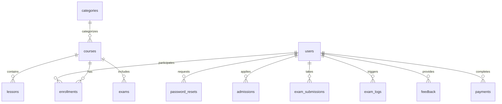

# Database Documentation: PostgreSQL 18 Architecture

**Target Database:** PostgreSQL 18
**Client Driver:** `pg` (v8.18.0) with Connection Pooling
**Schema Definition File:** `db/schema.sql`
**Migration & Seeder Script:** `server/scripts/migrate.js`

---

## 1. Relational Entity-Relationship Model



---

## 2. Table Specifications

### 1. `users`
- `id`: `SERIAL PRIMARY KEY`
- `uuid`: `UUID DEFAULT uuid_generate_v4() UNIQUE`
- `name`: `VARCHAR(100) NOT NULL`
- `email`: `VARCHAR(255) UNIQUE NOT NULL`
- `password_hash`: `VARCHAR(255) NOT NULL` (Bcrypt hash)
- `phone`: `VARCHAR(25)`
- `dob`: `DATE`
- `designation`: `VARCHAR(100) DEFAULT 'Student'`
- `role`: `VARCHAR(20) DEFAULT 'student' CHECK (role IN ('student', 'teacher', 'admin'))`
- `avatar_url`: `VARCHAR(255) DEFAULT '/assets/images/pic-1.jpg'`
- `is_active`: `BOOLEAN DEFAULT TRUE`
- `created_at`, `updated_at`: `TIMESTAMP WITH TIME ZONE`
- *Indexes*: `idx_users_email`, `idx_users_role`

### 2. `password_resets`
- `id`: `SERIAL PRIMARY KEY`
- `user_id`: `INT REFERENCES users(id) ON DELETE CASCADE`
- `email`: `VARCHAR(255) NOT NULL`
- `token`: `VARCHAR(255) UNIQUE NOT NULL`
- `expires_at`: `TIMESTAMP WITH TIME ZONE NOT NULL`
- `used`: `BOOLEAN DEFAULT FALSE`
- `created_at`: `TIMESTAMP WITH TIME ZONE DEFAULT CURRENT_TIMESTAMP`
- *Indexes*: `idx_password_resets_token`, `idx_password_resets_email`

### 3. `admissions`
- `id`: `SERIAL PRIMARY KEY`
- `user_id`: `INT REFERENCES users(id) ON DELETE SET NULL`
- `full_name`: `VARCHAR(150) NOT NULL`
- `dob`: `DATE NOT NULL`
- `gender`: `VARCHAR(20) CHECK (gender IN ('male', 'female', 'other'))`
- `previous_degree`: `VARCHAR(100) NOT NULL`
- `cgpa`: `NUMERIC(4, 2)`
- `year_of_passing`: `INT`
- `email`: `VARCHAR(255) NOT NULL`
- `phone`: `VARCHAR(25) NOT NULL`
- `address`: `TEXT NOT NULL`
- `status`: `VARCHAR(30) DEFAULT 'pending' CHECK (status IN ('pending', 'approved', 'rejected'))`
- `created_at`: `TIMESTAMP WITH TIME ZONE DEFAULT CURRENT_TIMESTAMP`
- *Indexes*: `idx_admissions_email`, `idx_admissions_status`

### 4. `categories` & `courses`
- Supports curriculum classification (`Development`, `Data Science`, `Design`, `Business`).
- Foreign keys ensure lessons and exams cascade cleanly upon course updates.

### 5. `exam_logs`
- `id`: `SERIAL PRIMARY KEY`
- `user_id`: `INT REFERENCES users(id) ON DELETE SET NULL`
- `student`: `VARCHAR(255) NOT NULL`
- `event`: `VARCHAR(100) NOT NULL`
- `details`: `TEXT`
- `image_url`: `TEXT`
- `timestamp`: `TIMESTAMP WITH TIME ZONE DEFAULT CURRENT_TIMESTAMP`
- *Indexes*: `idx_exam_logs_student`, `idx_exam_logs_event`, `idx_exam_logs_timestamp`

---

## 3. Database Migration & Seeding Instructions

### Initial Setup
1. Ensure PostgreSQL 18 is running and create the database:
   ```sql
   CREATE DATABASE education_platform;
   ```
2. Configure `.env` with your credentials:
   ```ini
   DATABASE_URL=postgresql://<USER>:<PASSWORD>@<HOST>:5432/<DATABASE>
   ```
3. Run the automated migration tool:
   ```bash
   npm run db:migrate
   ```
   *This executes all DDL queries, creates indexes and constraints, and seeds default instructor/student accounts.*
